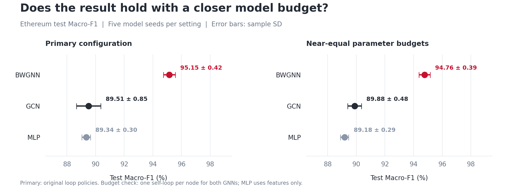
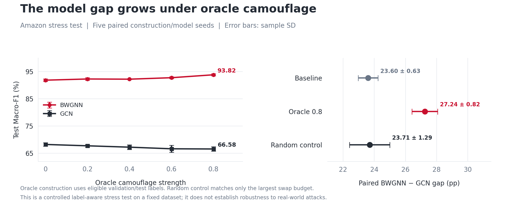

<p align="center">
  
</p>

<h1 align="center">BWGNN &amp; Graph Fraud Detection</h1>

<p align="center">
  <strong>From paper reproduction to Ethereum experiments and controlled camouflage tests</strong>
</p>

<p align="center">
  <a href="https://proceedings.mlr.press/v162/tang22b.html">Original paper</a> ·
  <a href="#results-at-a-glance">Results</a> ·
  <a href="#quick-start">Quick start</a> ·
  <a href="#where-to-find-the-evidence">Evidence</a> ·
  <a href="docs/REPRODUCIBILITY.md">Full reproduction guide</a>
</p>

---

## Overview

This is my COMP8240 Assessment 3 project at Macquarie University. I started by reproducing two settings from **Rethinking Graph Neural Networks for Anomaly Detection** by Tang et al. (ICML 2022). I then tested BWGNN on a constructed Ethereum fraud graph and compared it with GCN and a feature-only MLP.

The question I wanted to explore was simple: **how well does BWGNN perform when I change the dataset, the graph construction, and the way suspicious nodes connect to other nodes?**

BWGNN is the original authors' model. My work here covers reproduction, data preparation, baseline comparisons, sensitivity checks, and controlled experiments. I also added a small LLM study to check whether short descriptions stay within the evidence supplied to them.

<p align="center">
  
</p>

### Project snapshot

| Item | Details |
|---|---|
| Student | **Alireza Yegane** · 60957107 |
| University / unit | Macquarie University · **COMP8240, Assessment 3** |
| Source paper | [Tang et al., ICML 2022](https://proceedings.mlr.press/v162/tang22b.html) |
| Original code | [squareRoot3/Rethinking-Anomaly-Detection](https://github.com/squareRoot3/Rethinking-Anomaly-Detection) |
| Reproduced settings | Amazon: 40% training, homogeneous graph; YelpChi: 1% training, heterogeneous graph |
| Extensions | Ethereum evaluation; Amazon oracle camouflage; capacity, loop, filter-order and construction checks |
| Implementation | Python · PyTorch · DGL · scikit-learn |
| Verified platform | Windows · Python 3.8.20 · CPU with 16 threads |

## Results at a glance

The tables below report **my extension experiments**, separately from the original-paper reproduction. Values are means ± **sample standard deviation** across five seeds unless stated otherwise. Macro-F1, ROC-AUC and AP are shown as percentages; model gaps use percentage points (**pp**).

### 1. Ethereum: BWGNN stays ahead in the budget check

| Model | Primary test Macro-F1 (%) | ROC-AUC (%) | Average precision (%) |
|---|---:|---:|---:|
| **BWGNN** | **95.15 ± 0.42** | **98.59 ± 0.22** | **95.76 ± 0.42** |
| GCN | 89.51 ± 0.85 | 96.06 ± 0.28 | 89.35 ± 0.69 |
| MLP | 89.34 ± 0.30 | 96.64 ± 0.12 | 86.36 ± 1.84 |

The primary models have different sizes and loop policies. I therefore also ran a comparison with near-equal parameter budgets and one self-loop per node for both GNNs.

| Model | Parameters in budget check | Test Macro-F1 (%) |
|---|---:|---:|
| **BWGNN** | 1,394 | **94.76 ± 0.39** |
| GCN | 1,388 | 89.88 ± 0.48 |
| MLP | 1,402 | 89.18 ± 0.29 |

<p align="center">
  
</p>

The paired BWGNN–GCN gap in the budget check is **4.88 ± 0.80 pp**, positive in all five seeds. This makes the comparison more informative, although similar parameter counts do not make the models equally expressive.

[Primary results](results/comp8240_a3_core_analysis/summary_by_condition.csv) · [Budget-check results](results/comp8240_a3_sensitivity_analysis/sensitivity_summary.csv) · [Paired differences](results/comp8240_a3_sensitivity_analysis/paired_sensitivity_comparisons.csv)

### 2. Amazon: a wider gap under oracle camouflage

| Condition | BWGNN Macro-F1 (%) | GCN Macro-F1 (%) | Paired BWGNN–GCN gap (pp) |
|---|---:|---:|---:|
| Baseline | **91.85 ± 0.45** | 68.25 ± 0.63 | 23.60 ± 0.63 |
| Oracle camouflage, strength 0.8 | **93.82 ± 0.41** | 66.58 ± 0.82 | 27.24 ± 0.82 |
| Maximum-budget random control | **92.10 ± 0.38** | 68.39 ± 1.14 | 23.71 ± 1.29 |

<p align="center">
  
</p>

The strongest oracle condition increases the paired gap by **3.64 ± 1.01 pp** relative to baseline and **3.53 ± 1.13 pp** relative to the random control. Both changes are positive in all five paired seeds.

**Important context:** the rewiring uses eligible labels, including validation and test labels. This is a label-aware stress test, so I interpret it as a controlled experiment rather than evidence of real-world attack robustness. The random control matches the largest swap budget only. Construction and model seeds are paired, not crossed.

[All condition summaries](results/comp8240_a3_core_analysis/summary_by_condition.csv) · [Per-seed paired gaps](results/comp8240_a3_core_analysis/paired_model_gaps.csv) · [Interpretation notes](results/comp8240_a3_core_analysis/CORE_RESULTS_REVIEW.md)

### 3. Ethereum: checking a different construction

I also changed the matched negative selection and sampled context, then repeated the three-model comparison with three model seeds per construction.

| Construction seed | BWGNN Macro-F1 (%) | GCN Macro-F1 (%) | MLP Macro-F1 (%) |
|---|---:|---:|---:|
| 0 — original reference | **95.01 ± 0.30** | 89.77 ± 0.79 | 89.49 ± 0.30 |
| 1 | **95.07 ± 0.32** | 90.52 ± 0.55 | 90.00 ± 0.29 |
| 2 | **94.66 ± 0.14** | 89.77 ± 0.58 | 87.84 ± 0.19 |

BWGNN leads both baselines in all nine construction/model-seed pairs. These are three samples from **one released snapshot**, with the same positive identities, including all 468 held-out positives. They therefore check joint construction sensitivity; they do not test transfer to independent datasets or new positive identities. The three-seed reference above is kept separate from the five-seed primary summary.

[Construction summaries](results/comp8240_a3_sampling_analysis/sampling_summary.csv) · [Overlap checks](results/comp8240_a3_sampling_analysis/construction_overlap.csv)

### Other sensitivity checks

| Check | What I observed |
|---|---|
| BWGNN self-loops | Adding one loop per node changes primary Macro-F1 by **−0.42 ± 0.39 pp** across five paired seeds. |
| Filter order | C=5 has the highest mean validation Macro-F1 among C=1/2/3/5. Test Macro-F1 is **95.14%**, compared with **95.15%** for C=2. |
| Primary configuration | **C=2 remains the primary result.** The filter-order check does not provide a meaningful observed test improvement. |

[Full sensitivity review](results/comp8240_a3_sensitivity_analysis/SENSITIVITY_RESULTS_REVIEW.md)

## Small explanation-support study

For eight Ethereum test cases, I prepared three short texts per case: a grounded description, a mixed unsupported-attribution control, and an unsupported-intent control. Gemini 3.6 Flash assessed the same 24 texts in three separate single-turn API requests with different fixed presentation orders.

| Text family | Texts per run | Result in each of the three runs |
|---|---:|---|
| Grounded description | 8 | 8 supported |
| Mixed attribution control | 8 | 8 partly_supported |
| Unsupported intent control | 8 | 8 speculative |

Each pair of runs agrees on all 24 texts: **100% exact agreement; unweighted Cohen's κ = 1.00**. I treat this as repeat consistency on simple constructed controls. The texts are rule-written rather than BWGNN-native explanations, and these ratings do not establish causal faithfulness or fraud-detection accuracy. The earlier human-review draft was AI-assisted, so I report no independent human–LLM agreement.

[Audited ratings](results/explanation_judge/all_ratings_audited.csv) · [Raw responses and requests](results/explanation_judge/evidence/) · [Study review and limitations](results/explanation_judge/JUDGE_RESULTS_REVIEW.md)

## How the experiments fit together

| Part | New model fits | What it checks |
|---|---:|---|
| Core extension batch | 75 | Ethereum: 3 models × 5 seeds. Amazon: 6 conditions × 2 models × 5 paired seeds. |
| Capacity, loop and order checks | 35 | Near-equal budgets, one-loop BWGNN, and C=1/3/5; existing C=2 results reused. |
| Construction sensitivity | 18 | Two new constructions × 3 model seeds × 3 models; nine reference results reused. |
| **Total** | **128** | **12,800 epochs. Original replication and toy self-checks are excluded.** |

For the extensions, I fit the standardizer using training roots only and use validation data to select checkpoints and decision thresholds. The original-paper reproduction keeps its released evaluation semantics. The detailed guide explains that distinction and the use of logit-margin scores for ROC-AUC and AP.

## Quick start

For a fast check of the included tables and raw judge evidence, run `python verify_public_results.py` with Python 3.8 or later. It uses only the standard library and makes no network/API requests or model fits. See the [marker guide](docs/MARKER_GUIDE.md) for what each check establishes.

The tested stack is **Python 3.8.20, NumPy 1.23.5, PyTorch 1.9.0, DGL 0.8.1, SciPy 1.10.1 and scikit-learn 1.3.2**. SymPy 1.13.3 and NetworkX 3.1 are also recorded in the environment file. The target platform is Windows; historical wheel availability on other platforms has not been verified.

From a new checkout:

```powershell
git clone https://github.com/AlirezaYegane/BWGNN-Fraud-Detection.git
cd BWGNN-Fraud-Detection
conda env create -f environment.yml
conda activate bwgnn-a3
python bootstrap_upstream.py
python verify_submission.py --runtime
```

The bootstrap downloads three unchanged original model files from the pinned upstream commit and checks their fingerprints. The runtime check runs small preprocessing and model checks; it does not repeat the full experiment batches. If you already have the verified environment, use it and follow the [existing-environment instructions](docs/REPRODUCIBILITY.md).

<details>
<summary><strong>Original reproduction commands</strong></summary>

Run from the repository root after the bootstrap. DGL downloads Amazon/YelpChi when needed; an existing cache can be reused.

```powershell
python main.py --dataset amazon --train_ratio 0.4 --hid_dim 64 --order 2 --homo 1 --epoch 100 --run 10
python audit_bwgnn.py --dataset yelp --train_ratio 0.01 --hid_dim 64 --order 2 --homo 0 --epoch 100 --seeds 0 1 2 3 4 5 6 7 8 9
python audit_bwgnn.py --dataset amazon --train_ratio 0.4 --hid_dim 64 --order 2 --homo 1 --epoch 100 --seeds 0 1 2 3 4
```

The archived ten-run Amazon reproduction is unseeded. Its exact individual values are not promised on rerun. Historical reproduction summaries use population SD; extension tables on this page use sample SD.

</details>

<details>
<summary><strong>Verify saved results without repeating training or API calls</strong></summary>

Large training evidence is stored separately from Git. Once its archives are available locally:

```powershell
python verify_submission.py --core "EXTRACTED_CORE" --sensitivity "EXTRACTED_SENSITIVITY"
python verify_sampling.py --sampling "EXTRACTED_SAMPLING" --core "EXTRACTED_CORE" --baseline-dataset "ORIGINAL_SEED0_DATASET.npz" --output "LOCAL_SAMPLING_CHECKS"
python results/explanation_judge/audit_judge_evidence.py --evidence "GEMINI_JUDGE_EVIDENCE.zip" --output "LOCAL_JUDGE_CHECKS"
```

The source drivers retain their archived input fingerprints. Freshly rebuilt data has new provenance and should use the [general reconstruction commands](docs/DATA_AND_COMMANDS.md), rather than bypassing the archived checks.

</details>

## Where to find the evidence

| Folder / file | Contents |
|---|---|
| [`docs/DATA_AND_COMMANDS.md`](docs/DATA_AND_COMMANDS.md) | Data provenance, feature construction and general experiment commands |
| [`docs/REPRODUCIBILITY.md`](docs/REPRODUCIBILITY.md) | Full environment, reproduction and saved-evidence verification notes |
| [`docs/WINDOWS_RUNTIME_VALIDATION.json`](docs/WINDOWS_RUNTIME_VALIDATION.json) | Actual Windows runtime receipt: preprocessing, instrumentation, three models, 75 core and 35 sensitivity fits |
| [`results/comp8240_a3_core_analysis/`](results/comp8240_a3_core_analysis/) | Ethereum and Amazon summaries, paired differences and audits |
| [`results/comp8240_a3_sensitivity_analysis/`](results/comp8240_a3_sensitivity_analysis/) | Capacity, loop and filter-order comparisons |
| [`results/comp8240_a3_sampling_analysis/`](results/comp8240_a3_sampling_analysis/) | Construction checks and graph-overlap analysis |
| [`results/explanation_judge/`](results/explanation_judge/) | All 72 ratings, anonymous raw evidence and the independent audit |
| [`explanation_study/`](explanation_study/) | Original frozen casepack, prompts and blank pre-execution templates |
| [`gemini_api/`](gemini_api/) | Actual judge runner and SSL/overload recovery code |
| [`THIRD_PARTY.md`](THIRD_PARTY.md) | Original-code attribution and source handling |

The [current readiness tracker](docs/RUBRIC_TRACKER.md) supersedes historical trackers in the training-analysis folders. The original frozen study manifest still says `prepared_not_executed`, because it records the plan before execution. The completed results and actual execution metadata are under `results/explanation_judge/`. The historical `openai_api/` alternative produced no judge output; Gemini is the source of the reported ratings.

## What these results can and cannot tell us

- **Labels need care.** Ethereum proxy negatives are sampled unlabelled accounts, not verified benign accounts. The 20% positive share among labelled roots is a construction choice.
- **The graph is a sample.** Negative matching, sampled context and the released static snapshot limit what I can conclude about other populations or future transactions.
- **The oracle has extra information.** Amazon rewiring uses validation/test labels and a random control matched only at the maximum swap budget.
- **A better score is not a mechanism explanation.** The comparisons do not establish that a particular spectral mechanism caused the performance gap.
- **The judge pilot is small.** Eight cases and repeated templates are useful checks, but they do not establish real-world explanation quality or independent human agreement.

Raw addresses, full data arrays, model checkpoints and credentials are excluded from ordinary Git commits. The final ACL report is prepared separately from this code repository.

## Acknowledgements and citation

This project builds on **Jianheng Tang, Jiajin Li, Ziqi Gao and Jia Li's BWGNN work**. Please cite the original paper when using the model:

```bibtex
@InProceedings{pmlr-v162-tang22b,
  title     = {Rethinking Graph Neural Networks for Anomaly Detection},
  author    = {Tang, Jianheng and Li, Jiajin and Gao, Ziqi and Li, Jia},
  booktitle = {Proceedings of the 39th International Conference on Machine Learning},
  pages     = {21076--21089},
  year      = {2022},
  volume    = {162},
  series    = {Proceedings of Machine Learning Research},
  url       = {https://proceedings.mlr.press/v162/tang22b.html}
}
```

AI tools helped with code and documentation preparation and review. The reported experiment outputs come from the saved runs linked above; Gemini's role is limited to the secondary factual-support pilot.

---

<p align="center">
  <strong>Alireza Yegane · Macquarie University</strong><br/>
  COMP8240 · Assessment 3 · 2026
</p>
